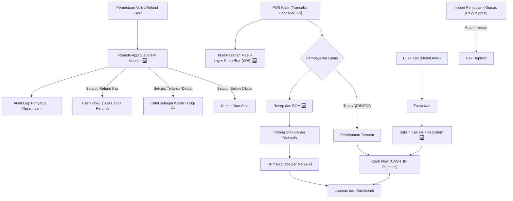
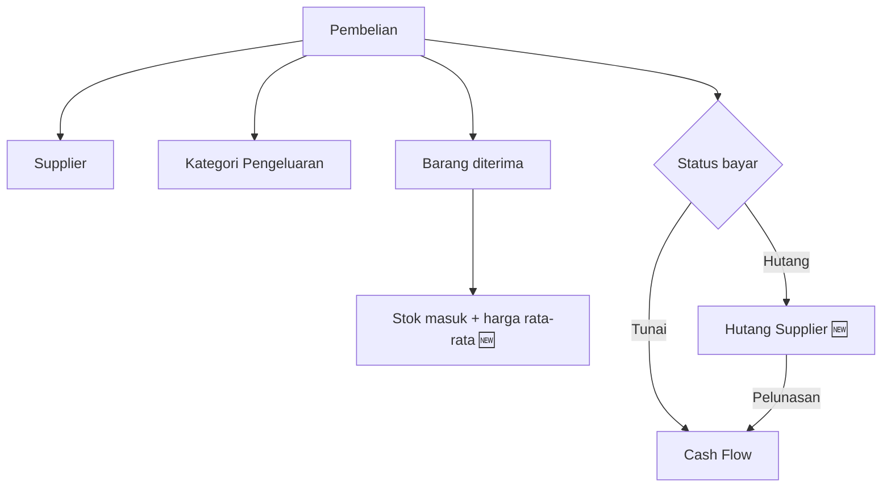
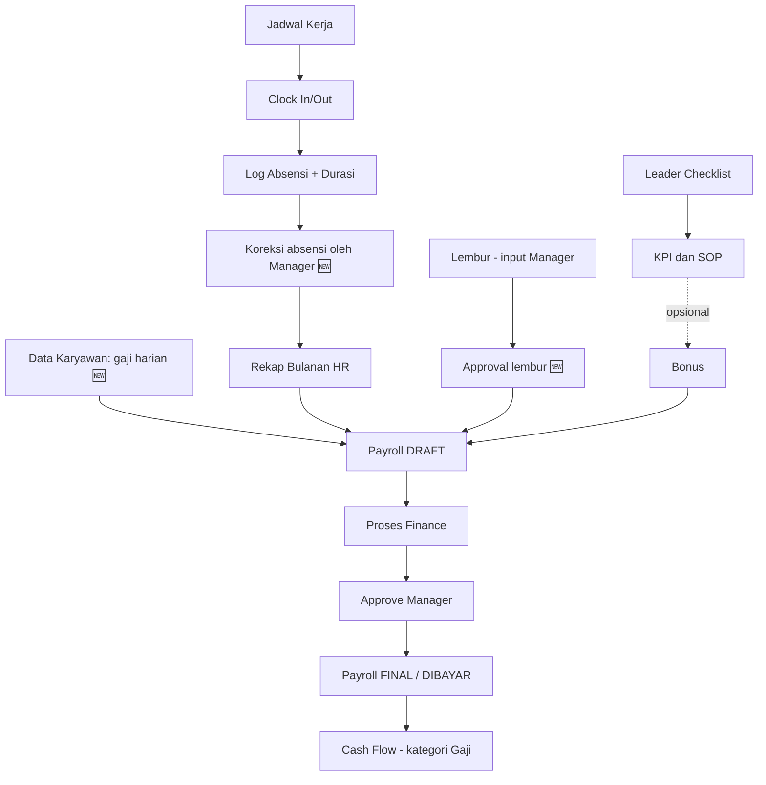
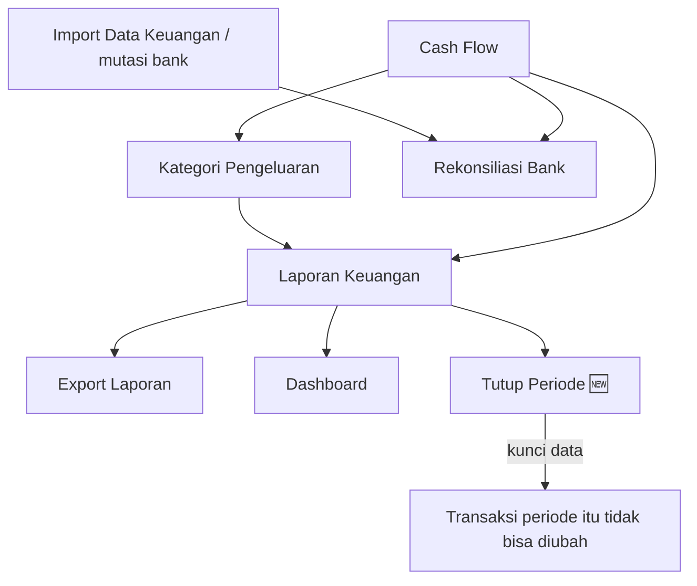
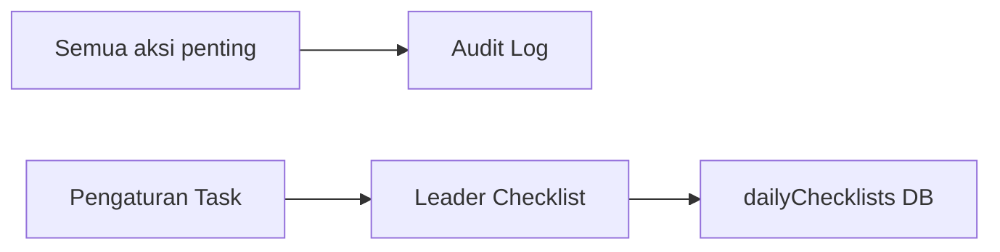
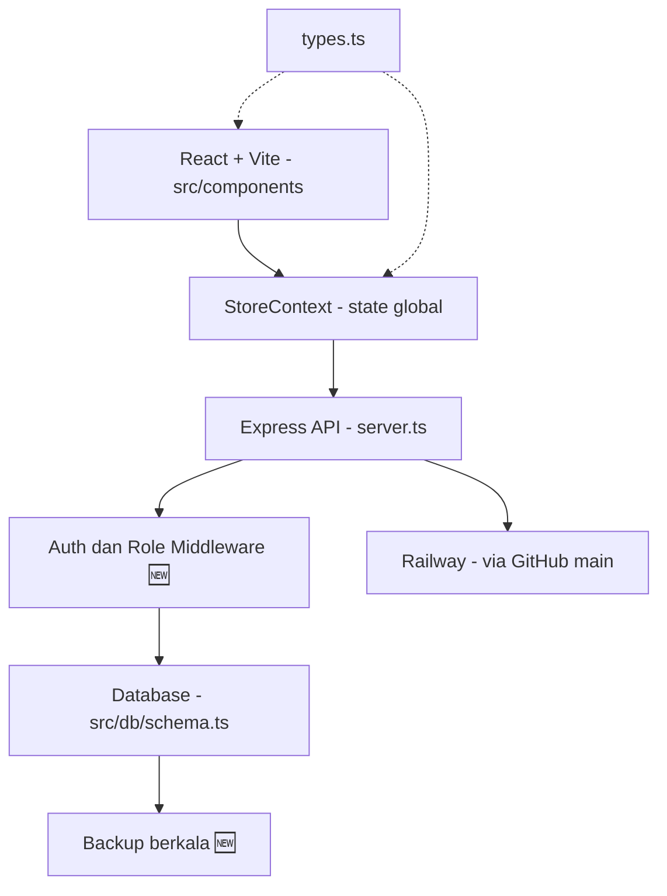

# 🗺️ Mind Map Aplikasi Coffee Management (v2)

> Legenda: 🆕 = modul/aturan baru yang disarankan, ⚠️ = bagian yang perlu dikonfirmasi dengan kode aktual.
> Dokumen ini disusun dari mind map v1, bukan dari pembacaan kode, jadi cocokkan dulu dengan implementasi.

## 1. Peta Modul Keseluruhan

```mermaid
mindmap
  root((Coffee Management))
    Dasbor
      Dashboard Keuangan
      Dashboard Inventori
    Keuangan
      Cash Flow
      Kategori Pengeluaran
      Hutang Supplier 🆕
      Laporan Keuangan
        Laba Rugi 🆕
        Arus Kas
      Rekonsiliasi Bank
      Import Data Keuangan
      Export Laporan
      Tutup Periode 🆕
    Inventori
      Stok Bahan
      Resep dan BOM 🆕
      Stock Opname 🆕
      Waste dan Spoilage 🆕
      Import Penjualan (Data Historis/Arsip)
    Operasional
      POS Kasir 🆕
        Pesanan dan Pembayaran
        Dine In Meja dan Open Bill
        Pilih Promo Aktif (Tanpa Diskon Manual Bebas) 🆕
        Kunci Layar Terminal (Lock Screen) 🆕
        Persetujuan Void Refund Jarak Jauh 🆕
      Manajemen Promo dan Diskon 🆕
        Daftar Promo Aktif dan Nonaktif
        Diskon Persen dan Nominal
      Layar Antrean Dapur KDS 🆕
        Bar
        Kitchen
        Bakery
      Manajemen Shift Kasir
        1 Akun Terminal POS Bersama 🆕
        Buka Kas (Pilih PIC Kasir Dropdown dan Tim) 🆕
        Tutup Kas dan Rekonsiliasi Laci Fisik
        Selisih Kas Fisik vs Sistem 🆕
      Supplier
      Pembelian
    SDM
      Manajemen HR
        Data Karyawan
        Jadwal Kerja
        Rekap Absensi Bulanan
        KPI dan SOP
      Clock In Out
        Durasi Kerja 8 Jam
        Koreksi Absensi 🆕
      Payroll
        Hari Hadir x Gaji Harian
        Bonus
        Lembur Input Manager
        Approval Lembur 🆕
        Status Draft Final Dibayar 🆕
      Leader Checklist
        Head Bar
        Head Kitchen
    Admin
      Users dan Role
      Audit Log
      Perangkat Terhubung
      Pengaturan
        Task Leader Bar
        Task Leader Kitchen
    Akun
      Login
      Ganti Akun
```

**Catatan penamaan:** "Manajemen Shift" (kasir: buka/tutup kas) dan "Jadwal" (HR: jadwal kerja karyawan) mudah tertukar. Di UI sebaiknya diberi nama berbeda, misalnya **Shift Kasir** dan **Jadwal Kerja**.

## 2. Matriks Role → Akses

Tabel ini usulan. Sesuaikan dengan `Layout.tsx` dan `App.tsx`.

| Modul | SUPER_ADMIN | OWNER | MANAGER | FINANCE | KASIR | LEADER | BAR/KITCHEN | BAKER |
|---|:-:|:-:|:-:|:-:|:-:|:-:|:-:|:-:|
| Dashboard Keuangan | ✅ | 👁️ | 👁️ | ✅ | – | – | – | – |
| Dashboard Inventori | ✅ | 👁️ | ✅ | 👁️ | – | – | – | – |
| Cash Flow / Laporan | ✅ | 👁️ | 👁️ | ✅ | – | – | – | – |
| Rekonsiliasi Bank | ✅ | – | – | ✅ | – | – | – | – |
| Tutup Periode 🆕 | ✅ | – | ✅ (approve) | ✅ (proses) | – | – | – | – |
| Inventori / Resep | ✅ | – | ✅ | – | – | – | – | – |
| Pembelian / Supplier | ✅ | – | ✅ | ✅ | – | – | – | – |
| POS Kasir 🆕 | ✅ | – | ✅ | – | ✅ | – | – | – |
| Layar KDS (Bar/Kitchen/Baker) 🆕 | ✅ | – | ✅ | – | – | ✅ | ✅ | ✅ |
| Approval Void / Refund (Remote) 🆕 | ✅ | – | ✅ (approve) | – | ❌ (pemohon) | – | – | – |
| Manajemen Promo & Diskon 🆕 | ✅ | 👁️ | ✅ | – | – (hanya memilih) | – | – | – |
| Import Penjualan (Arsip) | ✅ | – | ✅ | – | ✅ | – | – | – |
| Shift Kasir | ✅ | – | ✅ | 👁️ | ✅ | – | – | – |
| Data Karyawan / Jadwal / KPI | ✅ | – | ✅ | – | – | – | – | – |
| Input Lembur | ✅ | – | ✅ | – | – | – | – | – |
| Payroll | ✅ | 👁️ (ringkasan total) | ✅ (approve) | ✅ (proses dan bayar) | – | – | – | – |
| Leader Checklist | ✅ | – | 👁️ | – | – | ✅ | ✅ (checklist sendiri) | – |
| Clock In/Out | ✅ | – | ✅ | ✅ | ✅ | ✅ | ✅ | ✅ |
| Users / Role / Pengaturan | ✅ | – | Pengaturan Task | – | – | – | – | – |
| Audit Log | ✅ | 👁️ | – | – | – | – | – | – |

✅ = penuh, 👁️ = hanya lihat, – = tidak ada akses.

Poin yang perlu diputuskan:
- **Prinsip Owner:** Owner hanya **melihat** Dashboard, Laporan, ringkasan total Payroll, dan Audit Log. Owner tidak perlu input atau approve apa pun; seluruh operasional dan persetujuan diserahkan ke Manager dan Finance.
- **Payroll:** Manager input lembur dan bonus, Finance memproses dan membayar, Manager approve. Dengan begitu yang menyiapkan dan yang menyetujui adalah orang berbeda, tanpa melibatkan Owner.
- **Tutup Periode:** Finance memproses, Manager approve.
- **Audit Log:** Owner bisa melihat (read-only) sebagai pengawasan tanpa harus ikut mengoperasikan.

> ⚠️ **Penting:** Akses di v1 diatur di `Layout.tsx` (menu) dan `App.tsx` (routing). Keduanya hanya **frontend**. Role juga harus dicek di `server.ts` (middleware per endpoint). Kalau tidak, user yang tahu URL API-nya bisa melewati pembatasan menu.

## 3. Alur Data Utama (dipecah per rantai)

### 3A. Rantai Penjualan (POS) → Stok → Keuangan



Prinsip Penjualan & Kasir:
- **POS Kasir adalah sumber pendapatan primer**: Setiap transaksi lunas langsung memotong stok bahan dan mencatat cash in di akun kas yang sesuai.
- **Promo Terotorisasi (No Freeform Discount)**: Kasir tidak bisa mengetik angka diskon bebas. Kasir hanya bisa memilih promo yang sedang berstatus AKTIF yang dikelola Manajer/Admin di back-office. Diskon dihitung sebelum pajak.
- **1 Akun Terminal POS + Dropdown PIC Shift**: Tablet kasir menggunakan 1 akun terminal permanen dengan PIN yang diatur Admin/Manager. Saat Buka Kas, staf memilih Penanggung Jawab Shift (PIC) dan kru pendamping lewat dropdown. Laporan Tutup Kas dan struk mengikat tanggung jawab fisik uang ke PIC tersebut.
- **Pengamanan Layar POS**: Tidak ada tombol keluar bebas di kasir. Kasir yang rehat menggunakan tombol *Kunci Layar*. Keluar hanya bisa melalui alur resmi *Tutup Shift*.
- **Remote In-App Approval**: Kasir tidak memasukkan PIN manajer di tablet bersama (mencegah PIN diintip). Permintaan void/refund terkirim langsung ke HP/dashboard manajer. Jika dibatalkan setelah terlanjur dibuat, bahan baku masuk ke laporan `Waste`.
- **Import Penjualan**: HANYA untuk arsip/migrasi historis atau darurat, bukan dijalankan harian bersamaan dengan POS (mencegah *double count* pendapatan dan pemotongan stok ganda).

### 3B. Rantai Pembelian



Masalah di v1: Pembelian langsung ke Cash Flow, padahal pembelian bisa dibayar belakangan. Cash Flow harus mencatat saat uang keluar, bukan saat PO dibuat.

### 3C. Rantai SDM → Payroll



Masalah di v1: Leader Checklist berhenti di database dan tidak dipakai ke mana-mana. Hubungkan ke KPI/SOP, dan bila relevan ke bonus.

### 3D. Rantai Keuangan dan Pelaporan



Masalah di v1: arah Cash Flow → Bank terbalik. Rekonsiliasi mencocokkan **mutasi bank (hasil import)** dengan **catatan Cash Flow**. Tutup Periode mencegah angka laporan berubah setelah payroll dan laporan final.

### 3E. Lintas modul



Audit Log minimal mencatat: edit/hapus transaksi, penyesuaian stok, koreksi absensi, finalisasi payroll, perubahan role, tutup periode.

## 4. Aturan Bisnis yang Perlu Dikunci

| # | Aturan | Alasan |
|---|---|---|
| 1 | Pendapatan operasional harian berasal dari POS Kasir; Import Penjualan hanya untuk arsip/migrasi; Shift Kasir mencatat selisih kas fisik vs sistem | Hindari double count penjualan dan stok |
| 2 | Cash Flow dicatat saat uang keluar/masuk, bukan saat dokumen dibuat | Laporan kas akurat |
| 3 | Clock Out lupa → status "perlu koreksi" dan hanya Manager yang bisa mengoreksi (tercatat di Audit Log) | Payroll tidak salah hitung |
| 4 | Durasi < 8 jam → kurang/izin; > 8 jam → hanya menjadi lembur jika disetujui Manager | Lembur tidak otomatis cair |
| 5 | Payroll punya status Draft → Final → Dibayar; Finance memproses, Manager approve (orang berbeda); hanya Final yang masuk Cash Flow, dan setelah Dibayar tidak bisa diedit | Integritas data gaji tanpa melibatkan Owner |
| 5b | Owner hanya read-only: tidak ada tombol tambah/ubah/hapus/approve di role OWNER, dan server menolak request tulis dari OWNER | Owner cukup memantau |
| 6 | Periode yang sudah ditutup mengunci semua transaksinya; perubahan harus lewat jurnal koreksi | Laporan tidak berubah diam-diam |
| 7 | Import Penjualan menolak file/baris duplikat (kunci: tanggal + nomor transaksi) | Cegah penjualan ganda |
| 8 | Stok minimum per bahan memunculkan peringatan di Dashboard Inventori | Cegah kehabisan bahan |
| 9 | Semua waktu disimpan UTC dan ditampilkan sesuai zona waktu kafe | Server Railway biasanya UTC; absensi di sekitar tengah malam bisa salah tanggal |
| 10 | Void dan Refund di POS wajib melalui Remote In-App Approval dari HP/dashboard Manajer (bukan ketik PIN di kasir) + wajib menyertakan alasan pembatalan | Mencegah PIN manajer diintip kasir (anti-shoulder surfing) dan mencegah manipulasi pembatalan sepihak |
| 10b | Jika order dibatalkan setelah terlanjur dibuat di bar/dapur, bahan baku dicatat sebagai WASTE (bukan dikembalikan ke stok) | Mencegah selisih stok fisik vs sistem |
| 11 | Terminal POS menggunakan 1 akun perangkat bersama; Buka Kasir wajib memilih Penanggung Jawab Shift (PIC) dan kru via dropdown; Laporan Tutup Kas & struk mengikat kas fisik ke PIC tersebut | Praktis tanpa repot banyak akun, namun akuntabilitas uang laci kasir tetap 100% terkunci per orang |
| 12 | Kasir DILARANG menginput diskon manual bebas; Kasir hanya bisa memilih dari daftar Promo/Diskon resmi yang diaktifkan Manajer/Admin; Diskon dihitung sebelum pajak | Mencegah diskon siluman/favoritisme kasir, mencegah salah hitung manual, dan menjaga akurasi laporan laba rugi |
| 13 | Layar POS tidak menyediakan tombol keluar langsung; Kasir yang izin rehat menggunakan tombol "Kunci Layar"; Logout hanya melalui alur resmi "Tutup Shift" setelah hitung kas fisik | Mencegah laci kas menggantung tanpa pertanggungjawaban (orphan shift) dan mencegah salah pencet saat jam ramai |

## 5. Arsitektur Teknis



| Lapisan | File Kunci |
|---|---|
| UI | `src/components/` |
| Menu dan akses (frontend) | `src/components/Layout.tsx`, `src/App.tsx` |
| State | `src/store/` |
| Tipe | `src/types.ts` |
| Skema DB | `src/db/` |
| Backend | `server.ts` |

Catatan: tautan `file:///c:/Users/...` di v1 sudah diganti path relatif supaya tetap bisa dibuka di GitHub dan mesin lain.

Checklist teknis:
- [ ] Cek role di sisi server untuk setiap endpoint sensitif (payroll, keuangan, users)
- [ ] Pastikan database Railway memakai volume/DB terkelola, dan atur backup otomatis
- [ ] Simpan rahasia (JWT secret, DB URL) di environment variable
- [ ] Beri pembatasan percobaan login (rate limit) dan session timeout, terutama untuk fitur "Ganti Akun" di perangkat bersama
- [ ] Gunakan satu util waktu untuk semua perhitungan tanggal (lihat aturan #9)

## 6. Prioritas Perbaikan

**Tinggi (memengaruhi kebenaran angka)**
1. Resep/BOM, supaya Import Penjualan bisa memotong stok
2. Aturan anti double count (Penjualan vs Shift Kasir)
3. Status bayar Pembelian dan Hutang Supplier
4. Status Payroll (Draft/Final/Dibayar) dan approval lembur
5. Role dicek di server, tidak hanya di menu

**Sedang**
6. Rekonsiliasi Bank memakai mutasi hasil import
7. Tutup Periode
8. Koreksi absensi dengan Audit Log
9. Stock opname dan waste

**Rendah**
10. Checklist → KPI → bonus
11. Laporan Laba Rugi dan HPP
12. Notifikasi stok minimum

## 7. Checklist Pengujian Manual

Siapkan data uji: 1 akun per role, 2-3 karyawan dengan gaji harian berbeda, 1 supplier, 3 bahan, 2 menu. Catat tiap temuan dengan format: **langkah → hasil yang diharapkan → hasil sebenarnya**.

- [ ] **Login dan role:** masuk dengan tiap role, cek menu yang tampil; buka URL terlarang langsung (misal `/payroll` sebagai KASIR) dan pastikan ditolak
- [ ] **Role Owner:** menu hanya Dashboard, Laporan, ringkasan Payroll, Audit Log; tidak ada tombol tambah/ubah/hapus/approve
- [ ] **Clock In/Out:** normal 8 jam; lupa Clock Out; shift melewati tengah malam
- [ ] **Payroll:** hitung manual (hari hadir × gaji harian + bonus + lembur) lalu bandingkan dengan sistem; cek apakah payroll yang sudah dibayar masih bisa diedit
- [ ] **Pembelian → Stok → Cash Flow:** stok bertambah, Cash Flow sesuai status bayar (tunai vs hutang)
- [ ] **Import Penjualan:** upload file yang sama dua kali (harus ditolak); stok berkurang sesuai resep; pendapatan masuk Cash Flow hanya sekali
- [ ] **Shift Kasir:** buka dan tutup kas; pastikan pendapatan tidak dobel dengan Import Penjualan
- [ ] **Laporan dan Rekonsiliasi:** total laporan sama dengan total Cash Flow; ekspor berfungsi
- [ ] **Audit Log:** aksi penting dari tes di atas tercatat (siapa, kapan, apa yang berubah)

## 8. Instruksi untuk Antigravity (Audit Kode terhadap Dokumen Ini)

Cara pakai: buka project `coffee management` di Antigravity, pastikan file ini ada di repo, lalu tempel prompt di bawah ke agent. Jalankan **tahap 1 dulu** (hanya membaca dan melaporkan), baru lanjut ke tahap 2 setelah laporan kamu tinjau.

### Tahap 1: Audit (read-only)

```text
Kamu bertindak sebagai code auditor. Baca file mind_map_aplikasi_v2.md di root repo
sebagai spesifikasi, lalu periksa kode aktual (src/, server.ts, src/db/schema.ts,
src/types.ts, src/store/, src/components/Layout.tsx, src/App.tsx).

ATURAN: JANGAN mengubah kode apa pun di tahap ini. Hanya baca dan laporkan.

Periksa tiap poin berikut dan beri status:
✅ Sesuai | ⚠️ Sebagian | ❌ Belum ada | ❓ Tidak bisa dipastikan

A. Role dan keamanan
 1. Apakah setiap endpoint di server.ts memeriksa autentikasi DAN role di sisi server
    (bukan hanya menu di Layout.tsx dan routing di App.tsx)?
 2. Apakah KASIR/BAR/KITCHEN/BAKER bisa memanggil endpoint payroll, keuangan,
    atau users secara langsung?
 3. Apakah password di-hash, secret ada di environment variable, ada rate limit login?
 4. Apakah matriks role di bagian 2 dokumen sesuai dengan implementasi?
 4b. Apakah role OWNER benar-benar read-only (UI dan server menolak semua request
    tulis/approve dari OWNER), dan hanya melihat Dashboard, Laporan, ringkasan Payroll,
    dan Audit Log?

B. Rantai Penjualan (3A)
 5. Apakah Import Penjualan menolak data duplikat?
 6. Apakah ada tabel/logika Resep atau BOM dan pemotongan stok otomatis?
 7. Apakah pendapatan bisa masuk Cash Flow dari lebih dari satu sumber
    (Import Penjualan dan Shift Kasir)? Jelaskan risiko double count.
 8. Apakah Shift Kasir menghitung selisih kas?

C. Rantai Pembelian (3B)
 9. Apakah Pembelian punya status bayar (tunai/hutang)? Kapan Cash Flow dibuat?
10. Apakah ada modul Hutang Supplier dan stok masuk saat barang diterima?

D. Rantai SDM dan Payroll (3C)
11. Bagaimana durasi kerja dihitung? Apa yang terjadi jika lupa Clock Out atau
    shift melewati tengah malam?
12. Apakah zona waktu ditangani konsisten (simpan UTC, tampil sesuai zona kafe)?
13. Apakah lembur memerlukan approval Manager?
14. Apakah Payroll punya status Draft/Final/Dibayar, dan apakah data yang sudah
    final terkunci dari edit?
15. Apakah rumus payroll = hari hadir x gaji harian + bonus + lembur sudah benar?
16. Apakah hasil Leader Checklist terhubung ke KPI atau bonus?

E. Keuangan dan pelaporan (3D)
17. Apakah Rekonsiliasi Bank mencocokkan mutasi hasil import dengan Cash Flow?
18. Apakah ada mekanisme Tutup Periode yang mengunci transaksi?
19. Apakah total di Laporan selalu sama dengan total di Cash Flow?

F. Audit Log dan data
20. Aksi apa saja yang dicatat Audit Log? Bandingkan dengan daftar minimal di bagian 3E.
21. Apakah skema database punya relasi/foreign key dan indeks yang memadai?
22. Apakah ada backup database untuk deployment di Railway?

FORMAT LAPORAN (simpan sebagai AUDIT_REPORT.md di root repo):
- Ringkasan: jumlah ✅ / ⚠️ / ❌ / ❓
- Tabel: No | Poin | Status | File:baris bukti | Temuan | Saran perbaikan | Prioritas (Tinggi/Sedang/Rendah)
- Daftar bug atau risiko tambahan yang kamu temukan di luar daftar ini
- Untuk setiap temuan, sebutkan file dan baris sebagai bukti. Jika tidak yakin,
  tulis ❓, jangan menebak.
```

### Tahap 2: Uji langsung di browser (opsional, jika agent bisa menjalankan app)

```text
Jalankan aplikasi secara lokal, lalu uji langsung lewat browser sesuai bagian 7
dokumen mind_map_aplikasi_v2.md. Gunakan data uji kecil yang hasilnya bisa
dihitung manual. Untuk setiap skenario laporkan: langkah, hasil yang diharapkan,
hasil sebenarnya, dan screenshot bila ada. Jangan memodifikasi data produksi;
gunakan database lokal/uji saja.
```

### Tahap 3: Perbaikan bertahap

```text
Berdasarkan AUDIT_REPORT.md, perbaiki temuan berprioritas Tinggi satu per satu,
mulai dari bagian 6 dokumen (Resep/BOM, anti double count, status bayar pembelian,
status payroll, role di server).
Untuk setiap perbaikan:
1. Jelaskan rencana perubahan dan file yang akan disentuh, lalu tunggu persetujuan saya.
2. Buat perubahan sekecil mungkin dan jangan refactor hal yang tidak diminta.
3. Tambahkan atau jalankan tes untuk perubahan itu.
4. Jika ada perubahan skema database, sediakan migrasi dan cara rollback.
5. Ringkas hasilnya sebelum lanjut ke temuan berikutnya.
Jangan push ke branch main; kerjakan di branch terpisah.
```

> Catatan: karena deployment Railway berjalan otomatis dari `main`, kerjakan perbaikan di branch terpisah dan gabungkan ke `main` hanya setelah dites. Jangan menjalankan tes yang menulis data ke database produksi.
